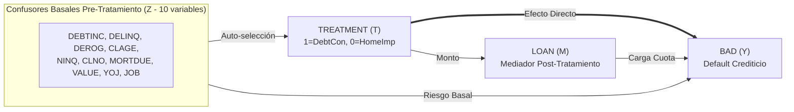

# Bitácora de Ingeniería (Decision Intelligence Capstone)

**Cátedra:** Estadística Aplicada y Modelos de Regresión (EAyMR 2026)  
**Institución:** Pontificia Universidad Católica Argentina (UCA) — Facultad de Ingeniería y Ciencias Agrarias  
**Profesor Titular:** Prof. Ivan Gonzalo Vilaboa  
**Equipo Scrum:** German Sittner (Project Lead & Fases 1–2) | Martín Peña (ML Engineer, Fase 3) | Santiago Salvatore (Causal Engineer, Fase 4)  
**Dataset Oficial:** HMEQ (Home Equity Loan Dataset, $N = 5.960$, 13 variables originales)

---

## Entrada 1 — Marco Estratégico, Contrato de Datos y Partición sin Data Leakage
*Responsable: German Sittner (Project Lead & Scrum Master)*  
*Auditoría: QA & Validation (Equipo EAyMR)*  
*Fecha: Noviembre 2026*

### 1.1 Preguntas Fundacionales de Negocio
En la gestión contemporánea de riesgo crediticio, una entidad financiera debe responder a dos desafíos complementarios antes de dividir el desarrollo en sus células técnicas:
1. **Predicción Observacional ($P(Y \mid X)$):** ¿Cuál es la probabilidad calibrada de que un solicitante entre en default (`BAD = 1`) dados sus antecedentes de buró e ingresos?
2. **Intervención y Decisión Causal ($P(Y \mid do(T = t))$):** Si la entidad interviene el sistema incentivando una política de consolidación de pasivos (`TREATMENT = 1`) en lugar de mejoras del hogar (`TREATMENT = 0`), ¿cuál es el verdadero impacto causal sobre la tasa de impago, aislando la situación financiera basal ($Z$)?

### 1.2 Selección y Fundamentación del Dataset
Se seleccionó y congeló el dataset **HMEQ (Home Equity Loan Dataset)**:
- **Volumen:** $N = 5.960$ observaciones (supera holgadamente el requisito de $N \ge 1.500$).
- **Heterogeneidad:** 13 variables que combinan atributos continuos (`LOAN`, `MORTDUE`, `VALUE`, `DEBTINC`), discretos (`DELINQ`, `DEROG`, `NINQ`, `CLNO`) y categóricos (`REASON`, `JOB`).
- **Exclusión de Toy Datasets:** Cumple la prohibición explícita de la cátedra de no utilizar datasets triviales (Iris, Titanic, Boston Housing, etc.), incorporando fricción real de datos bancarios.

### 1.3 Contrato Unificado de Variables para el Equipo Scrum
Definido en el código central `src/config.py`:
- **Target Principal ($Y$):** `BAD` (binaria, 1 = default, 0 = cumplidor). Tasa global de mora = $19.95\%$.
- **Target Continuo ($Y_{cont}$):** `LOAN` (monto del crédito solicitado).
- **Tratamiento Causal ($T$):** `TREATMENT` (binaria $0/1$), derivado de `REASON` ($1$ = `DebtCon`, $0$ = `HomeImp`).
- **Mediador Causal ($M$):** `LOAN` (excluido explícitamente de `CAUSAL_CONFOUNDERS` para evitar sobrecontrol en Fase 4).
- **Factor de Agrupación ANOVA:** `JOB` (6 ocupaciones: *Mgr, Office, Other, ProfExe, Sales, Self*).
- **Covariables / Confusores Basales ($Z$):** `MORTDUE`, `VALUE`, `YOJ`, `DEROG`, `DELINQ`, `CLAGE`, `NINQ`, `CLNO`, `DEBTINC` y `JOB`.

### 1.4 Diagnóstico de Nulos y Gobernanza de Imputación
- **Auditoría de Omisión en `DEBTINC` (21.26% de nulos):** Se estimó un modelo logit:  
  $$\text{logit}(P(\text{DEBTINC is missing})) = \beta_0 + \beta_1 \text{LOAN} + \beta_2 \text{VALUE} + \beta_3 \text{BAD}$$  
  El coeficiente de `BAD` arrojó $\beta = 2.79, z = 34.74, p < 10^{-16}$, demostrando que los clientes morosos tienen un Odds Ratio de omisión $\approx 16.3$ veces mayor.
- **Decisión Metodológica:** Se rechazó formalmente el mecanismo MCAR a favor de **MAR / MNAR**. Se prohíbe el descarte ciego de filas (`dropna()`) para evitar sesgo de selección y se añade la columna indicadora `DEBTINC_is_missing`.

### 1.5 Regla Estricta Anti-Leakage y Partición Oficial
- Los datos se dividieron **antes de cualquier imputación** en:
  - **Train:** 80% ($N = 4.768$ filas, tasa de default = $19.95\%$).
  - **Test:** 20% ($N = 1.192$ filas, tasa de default = $19.97\%$).
- Las medianas se aprendieron **únicamente sobre Train** y se transfirieron a Test.
- Los datasets finales quedaron fijados en `data/processed/train.csv`, `data/processed/test.csv` y `data/processed/metadata.json`.

---

## Entrada 2 — Matriz de Decisiones Estadísticas y Supuestos (Fase 1)
*Responsable: German Sittner (Project Lead & Econometría)*  
*Auditoría: QA & Validation (Equipo EAyMR)*  
*Fecha: Noviembre 2026*

### 2.1 Exploración Multidimensional y Comportamiento de Distribuciones
El análisis univariado y bivariado sobre `train.csv` ($N = 4.768$) evidenció fuertes asimetrías positivas y colas pesadas en variables de monto (`LOAN`, asimetría $> 2.0$ en categorías mayoritarias) y patrimonio (`VALUE`, `MORTDUE`), así como una fuerte correlación lineal entre el saldo hipotecario y el valor tasado del inmueble ($\rho_{\text{Pearson}} = 0.785$). La comparación entre matrices de Pearson y Spearman mostró discrepancias en variables de conteo de morosidad (`DELINQ`, `DEROG`), confirmando relaciones no lineales de rango.

### 2.2 Diagnóstico de Supuestos para ANOVA y Contrastes
- **El desafío de Shapiro-Wilk con $N \ge 1.500$:** Al aplicar Shapiro-Wilk sobre `LOAN` dentro de cada grupo ocupacional (`JOB`), todos los subgrupos rechazaron normalidad ($p \le 3.30 \times 10^{-3}$; en `Other` con $N=2.167$, $p = 6.95 \times 10^{-46}$). Se evaluaron asimetría y curtosis (`Mgr` $0.62$, `Sales` $0.51$, `Self` $0.81$ dentro de $[-1,1]$; `Other` $2.54$), respaldando inferencia asintótica por TCL y validando paralelamente con pruebas no paramétricas (Mann-Whitney $U$ y Kruskal-Wallis).
- **Homocedasticidad (Levene centrado en la mediana):** $W = 20.822, p = 1.22 \times 10^{-20}$. Se rechazó igualdad de varianzas, invalidando el ANOVA de Fisher y adoptando **Welch's ANOVA** ($F^* = 15.662, df_1 = 5, df_2 = 592.31, p = 1.71 \times 10^{-14}$) y **Kruskal-Wallis** ($H = 108.21, p = 9.77 \times 10^{-22}$).
- **Post-Hoc con control FWER:** Tukey HSD y comparaciones por pares **Welch $t$-test con corrección de Bonferroni** (15 pares): **8 pares significativos**, destacando que los trabajadores independientes (`Self`, media $\$29.515$) solicitan montos sustancialmente mayores (`Sales` $\$15.242$, `Other` $\$17.783$).

### 2.3 Resumen de Contrastes de Hipótesis Formales ($\alpha = 0.05$)
| Contraste | Hipótesis $H_0$ frente a $H_1$ | Estadístico & $p$-valor | IC 95% Diferencia | Cohen's $d$ | Conclusión |
|---|---|---|---|---|---|
| **Contraste 1 (`LOAN` según `BAD`)** | $H_0: \mu_0 = \mu_1$ $H_1: \mu_0 \neq \mu_1$ | Welch $t = 5.720, p = 1.25 \times 10^{-8}$ MWU $p = 5.87 \times 10^{-17}$ | $[-\$2.828, -\$1.384]$ | $-0.188$ | Se rechaza $H_0$. Los créditos en mora registran montos promedio inferiores ($\$16.922$ vs $\$19.028$), reflejo de racionamiento crediticio bancario ante mayor riesgo percibido. |
| **Contraste 2 (`DEBTINC` según `REASON`)** | $H_0: \mu_{\text{DebtCon}} = \mu_{\text{HomeImp}}$ $H_1: \mu_{\text{DebtCon}} > \mu_{\text{HomeImp}}$ | Welch $t = 3.795, p = 7.56 \times 10^{-5}$ MWU $p = 3.97 \times 10^{-6}$ | $[+\$0.50\%, +\$1.56\%]$ | $+0.125$ | Se rechaza $H_0$. Quienes consolidan deudas ingresan con un ratio deuda/ingreso basal significativamente superior ($34.31\%$ vs $33.28\%$). |

---

## Entrada 3 — Autopsia de Experimentos Fallidos (Data Autopsy) y Remediaciones (Fases 2, 3 y 4)
*Responsables: German Sittner (Fase 2), Martín Peña (Fase 3) y Santiago Salvatore (Fase 4)*  
*Fecha: Noviembre 2026*

```mermaid
flowchart TD
    subgraph P2 ["Fase 2: Econometría & PCA"]
        A2["Colinealidad NET_EQUITY + Outliers Cook's D"] --> B2["VIF infinito / MAE Test OLS $6,986.27"]
        B2 --> C2["Solución: Set base VIF<3, Huber MAE $6,785.45, PCA Train-only (3 PCs)"]
    end
    subgraph P3 ["Fase 3: Torneo ML & Calibración"]
        A3["CART sin poda (443 hojas) & GaussianNB crudo"] --> B3["Overfit Test AUC 0.7874 / Prob media NB 12.5%"]
        B3 --> C3["Solución: Poda ccp_alpha (30 hojas, AUC 0.8834) & Calibración Isotónica (20.1%)"]
    end
    subgraph P4 ["Fase 4: Inferencia Causal"]
        A4["Incluir LOAN en Backdoor + IPW sin trimming / DML cv=1"] --> B4["Atenuación 20.61% ATE / Pesos w>190 / Bias O(N^-1/4)"]
        B4 --> C4["Solución: LOAN como Mediador (M), Hájek IPW [0.025, 0.975], DML cv=5"]
    end
```

### 3.1 Fase 2 — Auditoría Gauss-Markov, Colinealidad y Puntos Influyentes (`train.csv`, $N = 4.768$)
- **Gauss-Markov sobre MCO para `LOAN` ($R^2 = 0.1218, F = 73.33, p = 2.24 \times 10^{-127}$):**
  - **Heterocedasticidad severa:** Breusch-Pagan ($LM = 118.26, p = 3.04 \times 10^{-21}$) y White ($LM = 451.72, p = 3.60 \times 10^{-64}$).
  - **No normalidad residual:** Jarque-Bera ($JB = 16.199, p < 10^{-50}$, $\text{Skew} = 2.11, \text{Kurt} = 10.98$).
  - **Independencia:** $DW = 1.9738 \approx 2.0$ en partición aleatoria estratificada (en el archivo crudo ordenado por lotes se observaba $DW = 0.325$ por artefacto de ordenamiento).
- **Fallo #1 (Colinealidad Perfecta al Introducir `NET_EQUITY`):** Agregar `NET_EQUITY = VALUE - MORTDUE` junto a ambas variables hizo singular a $X^T X$ ($\text{VIF} \to \infty$); `LTV_ratio` elevó VIF a $4.96$. Remediación: preservar variables base (`MORTDUE` $\text{VIF} = 2.77$, `VALUE` $\text{VIF} = 2.67$) y aplicar **PCA libre de fuga de datos** (scaler + PCA ajustados solo en Train; 3 componentes bajo Kaiser $\lambda_k > 1$ acumulando $52.30\%$ de varianza).
- **Fallo #2 (Distorsión por Outliers Reales y Cook's $D$):** Se detectaron **98 outliers** ($|r_i|>3$), **386 casos de alto apalancamiento** ($h_{ii} > 0.00419$) y **268 influyentes** ($D_i > 4/n = 0.000839$, máx $0.1687$). Remediación: **HuberRegressor** redujo el MAE en Test de $\$6.986,27$ (MCO) a **$\$6.785,45$**.

### 3.2 Fase 3 — Autopsia de Sobreajuste en CART y Descalibración en Naive Bayes
- **Fallo #3 (Árbol CART sin Poda Memoriza el Ruido):** Un `DecisionTreeClassifier` libre alcanzó $443$ hojas (profundidad $25$) con $\text{AUC}_{\text{Train}} = 1.000$ pero colapsó en Test a $\text{AUC}_{\text{Test}} = 0.7874$. Remediación: **Cost-Complexity Pruning (`ccp_alpha` por CV=5)** redujo el árbol a **$30$ hojas**, disparando $\text{AUC}_{\text{Test}}$ a **$0.8834$**.
- **Fallo #4 (Naive Bayes Subestima Riesgo Real por Independencia Violada):** Al existir correlaciones intra-clase (ej. `MORTDUE`–`VALUE` $\rho \approx 0.78$), `GaussianNB` multiplicaba evidencia redundante y predijo probabilidad media de default de apenas **$12.45\%$** (vs. $19.97\%$ real en Test, error de calibración $0.0752$, Brier $0.1399$, Recall $18.49\%$). Remediación: **Calibración Isotónica (`CalibratedClassifierCV`, `cv=5`)** corrigió la media a **$20.12\%$**, bajó el error de calibración a **$0.0235$** ($\text{Brier} = 0.1297$) y elevó el Recall a **$27.31\%$**.
- **Hallazgo de Ablación (`DEBTINC_is_missing`):** Al remover el indicador de faltante, la Regresión Logística cayó de $\text{AUC} = 0.8795$ a $0.7638$, mientras que Random Forest mantuvo $\text{AUC} = 0.9565$ al aislar localmente el valor constante imputado.

### 3.3 Fase 4 — Autopsia Causal: *The Mediator Trap*, IPW Extremo y DML sin Cross-Fitting
- **Fallo #5 (La Trampa del Mediador por Sobrecontrol de `LOAN`):** Quien consolida pasivos solicita montos mayores ($T \to \text{LOAN}$, media `DebtCon` $\$19.663$ vs `HomeImp` $\$15.931$, Welch $t = 9.94, p = 7.8 \times 10^{-23}$). Al incluir `LOAN` dentro de `common_causes`, el ATE estimado en DoWhy se atenuó artificialmente de $-0.0554$ a $-0.0440$ (**sesgo de sobrecontrol del $20.61\%$** al bloquear el Efecto Indirecto Natural). Remediación: excluir `LOAN` de `CAUSAL_CONFOUNDERS` en `src/config.py` y declararlo mediador $M$.
- **Fallo #6 (Pesos Extremos en IPW y Sesgo de Regularización en DML sin Cross-Fitting):** El estimador Horvitz-Thompson sufrió pesos $w_i > 190$ en las colas del propensity score, y un `LinearDML` con `cv=1` sufría sesgo de regularización $\mathcal{O}_p(N^{-1/4})$. Remediación: **Propensity Trimming $[0.025, 0.975]$ con estimador normalizado de Hájek** ($\widehat{\text{ATE}}_{\text{IPW}} = -0.0445$) y **Cross-Fitting formal `cv=5`** en `LinearDML` y `CausalForestDML`.

---

## Entrada 4 — Síntesis de Torneo ML, Formalización Causal (SCM/DAG) y Choque Epistemológico
*Responsables: Martín Peña (Fase 3) y Santiago Salvatore (Fase 4)*  
*Revisión: German Sittner*  
*Fecha: Noviembre 2026*

### 4.1 Torneo Predictivo Unificado sobre Test Ciego (`test.csv`, $N = 1.192$)
| Modelo | Precision | Recall | F1 Macro | F1 Weighted | AUC-ROC | PR-AUC | Brier Score |
|---|---|---|---|---|---|---|---|
| **Logística (Elastic Net)** | $0.7840$ | $0.5336$ | $0.7807$ | $0.8682$ | $0.8775$ | $0.7469$ | $0.0910$ |
| **Naive Bayes (Original)** | $0.7857$ | $0.1849$ | $0.6004$ | $0.7812$ | $0.7645$ | $0.5095$ | $0.1399$ |
| **Naive Bayes (Calibrado)** | $0.6915$ | $0.2731$ | $0.6466$ | $0.7997$ | $0.7649$ | $0.5180$ | $0.1297$ |
| **Árbol CART Podado (`30` hojas)** | $0.7172$ | $0.5966$ | $0.7867$ | $0.8679$ | $0.8834$ | $0.6744$ | $0.0931$ |
| **Random Forest (500 árb., OOB/CV)** | **$0.7929$** | **$0.6597$** | **$0.8288$** | **$0.8940$** | **$0.9516$** | **$0.8408$** | **$0.0697$** |

- **El Choque con la Fase 4:** En el modelo ganador (Random Forest), **`DEBTINC_is_missing`** es #1 en MDI ($0.2017$) / #2 en Permutación ($0.0393$) y **`DEBTINC`** es #1 en Permutación ($0.0450$) / #2 en MDI ($0.1602$), mientras la palanca de política **`TREATMENT`** queda relegada al **puesto #12 en MDI ($0.0102$) y #14 de 17 en Permutación ($0.0026$)**.

### 4.2 DAG Estructural, Identificación Backdoor y Estimación Causal (`train.csv`, $N = 4.768$)

- **Supuestos verificados:** SUTVA (contratos individuales sin interferencia), Ignorabilidad Condicional $(Y(0),Y(1)) \perp\!\!\perp T \mid \mathbf{Z}$ y Positividad garantizada en soporte común $[0.025, 0.975]$.
- **Estimaciones ATE y Sesgo de Confusión:**
  - Regresión Ingenua ($Y \sim T$): $\hat{\beta}_{\text{naive}} = -0.0336$ ($-3.36\text{ p.p.}$).
  - **ATE DoWhy Backdoor OLS:** $\widehat{\text{ATE}}_{\text{OLS}} = -0.0554$ ($-5.54\text{ p.p.}, p < 0.001$).
  - **ATE DoWhy IPW (Hájek):** $\widehat{\text{ATE}}_{\text{IPW}} = -0.0445$.
  - **Sesgo de Confusión Basal:** $+0.0219$ (**$39.5\%$ de subestimación relativa** en el estimador ingenuo porque quienes solicitan `DebtCon` arrastran peor `DEBTINC` y `DELINQ`).
- **Sensibilidad (E-Value):** Con $RR_{\text{causal}} = 1.331$, **$E\text{-Value} = 1.995$** (vs. $1.285$ observacional).
- **Heterogeneidad CATE (`EconML` `LinearDML` + `CausalForestDML`, `cv=5`):** Coeficientes `DEBTINC` $= +0.00380$, `VALUE` $= -2.07\times 10^{-7}$, `CLAGE` $= +0.00040$, Intercepto $= -0.2030$. Segmentación de cartera: **Persuadibles/Beneficiarios ($\tau < -2\%$):** $38.9\%$ ($1.855$); **Neutros:** $52.6\%$ ($2.507$); **Reactivos Adversos ($\tau > +2\%$):** $8.5\%$ ($406$).
- **Refutaciones DoWhy superadas (3/3):** *Random Common Cause* ($\widehat{\text{ATE}} = -0.0554$), *Placebo Treatment* ($\widehat{\text{ATE}} = +0.0004$, colapsa a cero), *Data Subset 80%* ($\widehat{\text{ATE}} = -0.0720$).

---

## Entrada 5 — Trazabilidad de Asistentes de IA y Quality Gate (`pytest`)
*Responsable: Equipo EAyMR 2026 (Auditoría Transversal QA)*  
*Fecha: Noviembre 2026*

### 5.1 Protocolo de Gobernanza con LLMs
1. **No Delegación Teórica:** Las variables del contrato (`src/config.py`), los tests de supuestos, el DAG causal y la separación entre Nivel 1 (predictivo) y Nivel 2 (intervención) fueron definidos por el equipo; los LLMs actuaron como asistentes de estructuración y refactorización modular.
2. **Validación Determinística:** Ningún bloque de código integró el repositorio sin ejecución limpia y validación por la suite automatizada `pytest`.

### 5.2 Matriz de Errores de IA Detectados y Refutados
| Propuesta / Sesgo de LLM | Falacia Metodológica | Refutación y Corrección del Equipo |
|---|---|---|
| Tratar `DEBTINC` o `DEBTINC_is_missing` como palancas de política por su liderazgo en MDI/Permutation. | Confusión Nivel 1 vs Nivel 2 de Pearl | Demostrado empíricamente en el Ensayo Crítico Unificado: `TREATMENT` (#14 en RF) tiene $\text{ATE} = -5.54\text{ p.p.}$, mientras `DEBTINC_is_missing` es un marcador MAR/MNAR. |
| Incluir `LOAN` dentro de `CAUSAL_CONFOUNDERS` en `DoWhy`. | *The Mediator Trap* (Sobrecontrol) | Se excluyó `LOAN` de `CAUSAL_CONFOUNDERS` en `src/config.py`, se fijó `CAUSAL_MEDIATOR = "LOAN"` y se blindó en `test_phase4.py`. |
| Usar `LinearDML(cv=1)` para acelerar ejecución. | *Regularization Bias* $\mathcal{O}_p(N^{-1/4})$ | Se impuso `cv=5` obligatorio en `src/phase4_causal.py` garantizando ortogonalidad de Neyman. |
| Descartar filas con nulos en `DEBTINC` mediante `dropna()`. | Sesgo de selección bajo MAR/MNAR | Se demostró $\text{OR} = 16.3\times$ en Fase 1, preservando `DEBTINC_is_missing` e imputando medianas solo sobre Train. |

### 5.3 Puerta de Calidad (`pytest` + Artefactos Serializados)
La suite unificada en `tests/` valida de punta a punta:
- `test_data_pipeline.py`: Contrato de variables, partición 80/20 y cero fuga de datos en imputación.
- `test_phase1.py`: Mecanismo MAR/MNAR, contrastes con Cohen's $d$, Levene y Welch ANOVA.
- `test_phase2.py`: Auditoría Gauss-Markov, Distancia de Cook, Huber vs OLS, VIF y ajuste PCA en Train-only.
- `test_phase3.py`: Matrices sin fuga, poda CART (menos hojas y mejor AUC en test) y calibración isotónica de Naive Bayes.
- `test_phase4.py`: DAG acíclico, `LOAN` como mediador fuera del ajuste backdoor, confusores y coherencia del ATE con las 3 refutaciones.
- `test_artifacts.py`: Integridad de los archivos de `artifacts/` que consume la Web App de Fase 5.

Resultado: **26 tests aprobados** (`python -m pytest tests/`).
