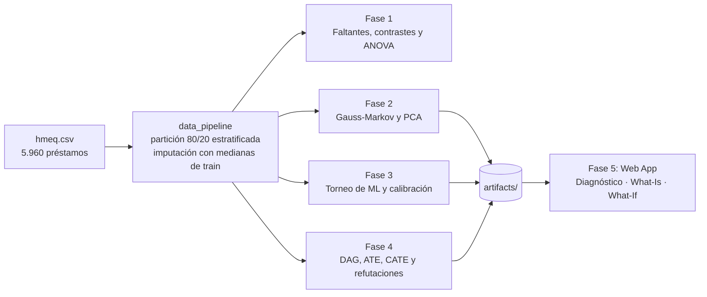
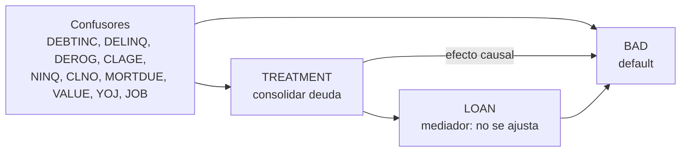

# Decision Intelligence Capstone: Riesgo crediticio en préstamos hipotecarios (HMEQ)

[](https://www.python.org/downloads/)
[](tests/)
[](#equipo)
[-blueviolet.svg)](#datos)

Trabajo Práctico Integrador de **Estadística Aplicada y Modelos de Regresión (EAyMR 2026)** — Pontificia Universidad Católica Argentina (UCA).

**🌐 Web App en producción:** [LINK DE LA APP]

---

## Pregunta del proyecto

El trabajo responde dos preguntas distintas sobre el mismo crédito:

1. **Predictiva (¿qué va a pasar?):** dado el perfil de un solicitante, ¿qué probabilidad tiene de entrar en default? → $P(\text{BAD}=1 \mid X)$
2. **Causal (¿qué pasa si intervenimos?):** si el banco orienta el crédito a consolidar deuda en lugar de mejoras del hogar, ¿cuánto cambia el default? → $P(\text{BAD}=1 \mid do(\text{TREATMENT}=1))$

## Flujo del proyecto



## Modelo causal (DAG)



## Resultados principales

| Fase | Resultado |
|---|---|
| 1. Inferencia y ANOVA | Los faltantes de `DEBTINC` no son aleatorios (OR = 16,3 si el cliente está en default). ANOVA de Welch del monto por ocupación: F = 15,7, p < 0,001. |
| 2. Gauss-Markov y PCA | El MCO del monto viola homocedasticidad y normalidad; Huber reduce el MAE en test. Tres componentes principales explican el 52,3 % de la varianza. |
| 3. Torneo predictivo | Gana **Random Forest**: AUC-ROC 0,952, PR-AUC 0,841 y Brier 0,070 en test. |
| 4. Inferencia causal | Consolidar deuda reduce el default **5,5 puntos porcentuales** (ATE con ajuste backdoor; IPW: −4,5). Pasa las 3 refutaciones de DoWhy. El efecto es protector con ratio deuda/ingreso de hasta 35 % y perjudicial por encima de 40 %. |
| 5. Web App | Streamlit con tres módulos: Diagnóstico (PCA 2D), Predictivo (What-Is) y Causal (What-If). |

## Datos

Dataset **HMEQ** (Home Equity): 5.960 préstamos con garantía hipotecaria, 12 variables explicativas y 19,9 % de default. La partición train/test (80/20, estratificada por `BAD`, semilla 42) se fija una sola vez en `src/data_pipeline.py`, y las medianas de imputación se aprenden solo con train.

| Rol | Variable | Definición |
|---|---|---|
| Objetivo binario ($Y$) | `BAD` | 1 = default, 0 = cumple |
| Objetivo continuo | `LOAN` | Monto del préstamo (Fase 2) |
| Tratamiento ($T$) | `TREATMENT` | 1 = consolidación de deuda (`DebtCon`), 0 = mejoras del hogar (`HomeImp`) |
| Mediador ($M$) | `LOAN` | Descendiente del tratamiento: no se ajusta por él en la Fase 4 |
| Factor ANOVA | `JOB` | Mgr, Office, Other, ProfExe, Sales, Self |
| Confusores ($Z$) | `MORTDUE, VALUE, YOJ, DEROG, DELINQ, CLAGE, NINQ, CLNO, DEBTINC, JOB` | Perfil patrimonial y de buró crediticio |

## Estructura del repositorio

```text
├── app/                      # Fase 5: Web App de Streamlit
│   ├── app.py
│   ├── requirements.txt      # Dependencias fijadas de la app
│   └── README.md             # Cómo correrla y publicarla
├── artifacts/                # Modelos y resultados que consume la app
├── data/
│   ├── hmeq.csv              # Dataset original
│   └── processed/            # train.csv, test.csv y metadata.json
├── notebooks/
│   └── TP_Integrador_Final.ipynb   # Notebook maestro (Fases 1 a 4 y ensayo)
├── src/
│   ├── config.py             # Contrato de variables del equipo
│   ├── data_pipeline.py      # Limpieza, imputación y partición
│   ├── phase1_inference.py
│   ├── phase2_econometrics.py
│   ├── phase3_ml.py
│   ├── phase4_causal.py
│   ├── export_phase1_2.py    # Exporta los artefactos de las Fases 1 y 2
│   └── export_app_cate.py    # Precalcula el CATE para la app
├── tests/                    # 26 tests de pytest
├── BITACORA.md               # Bitácora de decisiones (5 entradas)
└── requirements.txt
```

## Cómo reproducir el trabajo

```bash
git clone <URL_DEL_REPOSITORIO>
cd TPI-EayMR
pip install -r requirements.txt

# 1. Partición e imputación (genera data/processed/)
python -m src.data_pipeline

# 2. Artefactos de cada fase (genera artifacts/)
python -m src.export_phase1_2
python -m src.phase3_ml
python -m src.phase4_causal
python -m src.export_app_cate

# 3. Tests
python -m pytest tests/ -v

# 4. Notebook maestro
jupyter notebook notebooks/TP_Integrador_Final.ipynb
```

## Web App

Publicada en Streamlit Community Cloud: **[LINK DE LA APP]**

Para correrla en la computadora:

```bash
pip install -r app/requirements.txt
streamlit run app/app.py
```

Los detalles están en [`app/README.md`](app/README.md).

## Equipo

| Integrante | Rol |
|---|---|
| Germán Sittner | Project Lead · Fases 1 y 2 |
| Martín Peña | ML Engineer · Fase 3 |
| Santiago Salvatore | Causal Engineer · Fase 4 |

Las decisiones, los experimentos fallidos y el uso de IA están documentados en [`BITACORA.md`](BITACORA.md).
